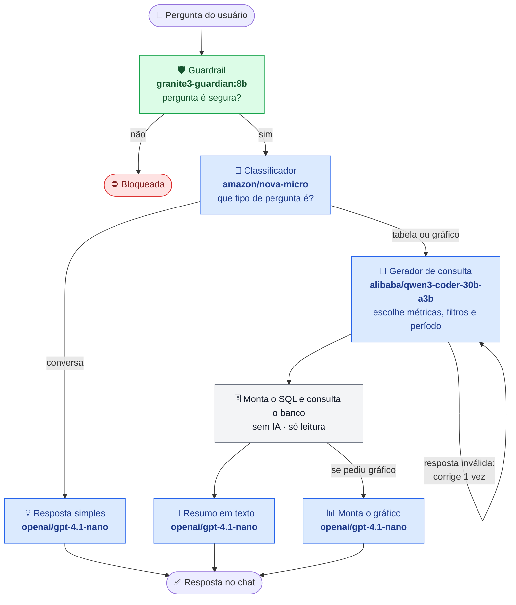

# Como a IA funciona no chat

A IA **nunca escreve SQL**: ela só escolhe itens de um catálogo fechado (métricas, agrupamentos, filtros).
O SQL de verdade é escrito à mão e montado pelo sistema.

🟩 IA local (Ollama) · 🟦 IA na nuvem (Vercel AI Gateway) · ⬜ sem IA

## Modelos

| Etapa | Modelo | Onde roda |
|---|---|---|
| Guardrail (barra pergunta perigosa) | `granite3-guardian:8b` | Local (Ollama) |
| Classificador (conversa, tabela ou gráfico) | `amazon/nova-micro` | Nuvem (AI Gateway) |
| Gerador de consulta | `alibaba/qwen3-coder-30b-a3b` | Nuvem (AI Gateway) |
| Gráfico | `openai/gpt-4.1-nano` | Nuvem (AI Gateway) |
| Resposta simples e resumo | `openai/gpt-4.1-nano` | Nuvem (AI Gateway) |

## Por que é seguro

- A IA só escolhe opções de uma lista; quem escreve o SQL é o sistema.
- Tudo que vem da pergunta entra como parâmetro, nunca como texto colado no SQL.
- O banco é acessado por um usuário só de leitura, com limite de 5 segundos e 500 linhas por consulta.
