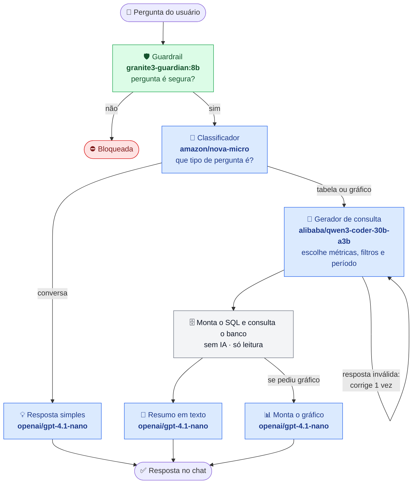

# dashboard-ia

BI: dashboards ECharts sobre dados fictícios de e-commerce, chatbot que traduz pergunta em pt-BR para uma consulta
semântica (via Vercel AI Gateway) — a IA nunca escreve SQL — e construtor manual de gráficos com presets de estilo.

Postgres em container, API Express e SPA Vite rodam na máquina; os modelos rodam no Vercel AI Gateway, exceto o guardrail,
que roda local no Ollama.

## Stack

| Camada | Escolha |
|---|---|
| `web` | React 19, TanStack Router (file-based, SPA), TanStack Query, Tailwind v4, shadcn/ui, ECharts 6 |
| `api` | Express 5, zod 4, Prisma 7 (`@prisma/adapter-pg`), `@modelcontextprotocol/sdk` |
| `shared` | ChartSpec, QuerySpec, Preset e `mergeOption` — fonte da verdade dos dois lados |
| dados | Postgres 13 (docker-compose, porta 42069) |
| LLM | Vercel AI Gateway via AI SDK (`ai`) + Ollama local (guardrail), um modelo por etapa, structured output com zod |

## Setup

Além de Bun e Docker, é preciso ter o [Ollama](https://ollama.com/download) instalado: o guardrail roda local
nele, e sem ele o chat não responde. Depois de instalar, baixe o modelo e deixe o Ollama rodando (o app já sobe o
servidor em `http://localhost:11434`; pelo terminal, `ollama serve`):

```bash
ollama pull granite3-guardian:8b
```

Se o Ollama estiver em outra máquina ou porta, ajuste `OLLAMA_BASE_URL` no `.env`.

```bash
bun install
cp .env.example .env # preencha VERCEL_GATEWAY_API_KEY
bun run setup        # sobe o Postgres, migra, popula e cria a role read-only
bun run dev          # api :3333 + web :5173
```

`bun run setup` executa `db:up`, `db:migrate`, `db:seed` e `db:readonly`. O seed gera ~24 meses de e-commerce
(8 regiões, 12 categorias, ~400 produtos, ~3.000 clientes, ~25.000 pedidos) com sazonalidade.

## Como a IA funciona



🟩 IA local (Ollama) · 🟦 IA na nuvem (Vercel AI Gateway) · ⬜ sem IA

| Etapa | Variável | Default | Onde roda |
|---|---|---|---|
| Guardrail (barra pergunta perigosa) | `AI_GUARDRAIL_MODEL` | `granite3-guardian:8b` | Ollama local |
| Classificador (conversa, tabela ou gráfico) | `AI_CLASSIFIER_MODEL` | `amazon/nova-micro` | AI Gateway |
| Gerador de consulta (`QuerySpec`) | `AI_QUERY_MODEL` | `alibaba/qwen3-coder-30b-a3b` | AI Gateway |
| Gráfico (`ChartSpec`) | `AI_CHART_MODEL` | `openai/gpt-4.1-nano` | AI Gateway |
| Resposta simples e resumo | `AI_SIMPLE_MODEL` | `openai/gpt-4.1-nano` | AI Gateway |

Defaults em `api/src/env.ts`. Nas etapas do Gateway, qualquer id do catálogo com suporte a structured output serve.
O guardrail precisa do Ollama rodando com o modelo baixado (ver [Setup](#setup)); se o Ollama estiver fora do ar,
o chat responde 503 em vez de liberar a pergunta.

## Como o chatbot chega no banco

A IA não vê tabela nem coluna: escolhe chaves de um catálogo fechado (`shared/src/query-spec.ts`) — métricas
(`receita`, `pedidos`, `ticket_medio`, `funil`…), até 2 agrupamentos (`mes`, `regiao`, `categoria`…), filtros,
período, ordenação e limite. O SQL de cada chave é escrito à mão em `api/src/semantic/registry.ts`.

Depois do guardrail e do classificador, nas rotas de tabela e gráfico:

1. Pergunta + catálogo semântico → modelo devolve um `QuerySpec` + `explanation` + `chartHint`.
2. O spec passa pelo zod do `shared`; se falhar, o erro volta ao modelo uma vez. `metrics: []` = pergunta fora
   do catálogo, vira mensagem amigável.
3. `compileQuery` monta o SQL com fragmentos `Prisma.sql` do registry; todo valor vindo do spec é parâmetro
   (`$1`, `$2`…), nunca texto interpolado.
4. Executa na pool da role `dashboard_ro`, dentro de transação read-only com `statement_timeout` de 5s, teto
   de 500 linhas.
5. Colunas + 20 linhas de amostra → modelo devolve o `ChartSpec`; se falhar, uma heurística local assume.
6. Toda tentativa vira linha em `QueryLog` (`rawOutput` do modelo + `compiledSql`).

A role `dashboard_ro` continua sem `GRANT` nas tabelas de estado (`Chart`, `ChartPreset`, `Conversation`,
`ChatMessage`, `QueryLog`) — defesa em profundidade.

### MCP

`bun run --cwd api mcp` sobe um servidor MCP (stdio) com as tools `list_metrics` e `query_metric`, sobre o
mesmo catálogo e compilador. Clientes como Claude Desktop ou Cursor consultam o banco sem nunca enviar SQL.
Para inspecionar: `bun x @modelcontextprotocol/inspector bun run --cwd api mcp`.

## Gráficos, estilo e presets

O modelo nunca emite cor literal: escolhe entre os tokens `chart-1`…`chart-5`, resolvidos no render a partir
das CSS custom properties do design system. Trocar light/dark recolore tudo sem regravar nada.

- **`/`** — visão geral: 4 KPIs + 6 gráficos fixos + seção **"Meus gráficos"** com os salvos que o usuário
  publicou. "Editar layout" liga o drag & drop (@dnd-kit): arrastar grava `pinnedOrder`, e cada card alterna
  entre meia linha e linha inteira (`layoutSpan`). "Atualizar dados" reexecuta a consulta de cada um.
- **`/chat`** — pergunta, consulta colapsável (chips do spec), tabela e gráfico; botão salva como `Chart` (`source: AI`).
- **`/charts`** — galeria dos gráficos salvos, com editar, mostrar na visão geral e excluir.
- **`/charts/:id`** — gráfico em tela cheia, editor de spec, formulário da consulta ("Executar" testa sem
  gravar), descrição, painel de estilo, barra de presets e controles de visão geral.
- **`/builder`** — monta a consulta pelo formulário, executa, mapeia colunas e salva (`source: MANUAL`).

O que persiste é a consulta + a spec, não o dado: `POST /api/charts/:id/run` recompila e reexecuta o `QuerySpec`
salvo.

Preset = patch parcial de `EChartsOption` deep-merged sobre a option base (`shared/src/preset.ts`). O zod
recusa qualquer patch que carregue `data`/`dataset` — preset estiliza, nunca injeta dado. `chartType: null`
faz o preset valer para qualquer gráfico.

## Endpoints

| Método | Rota |
|---|---|
| GET | `/api/health` — ping do banco + status do AI Gateway e dos modelos configurados |
| GET | `/api/dashboard/overview`, `/api/dashboard/series/:key` |
| GET | `/api/schema` — catálogo semântico (métricas, dimensões, valores de filtro) |
| POST | `/api/query/run` — `{ spec: QuerySpec }` |
| POST | `/api/chat` · GET `/api/chat/conversations[/:id]` |
| CRUD | `/api/charts` (`?pinned=true` = visão geral) · POST `/api/charts/:id/run` · POST `/api/charts/reorder` |
| CRUD | `/api/presets` (`?chartType=` filtra incluindo os globais) |

## Scripts

```bash
bun run dev           # api + web
bun run types         # tsc --noEmit nos dois workspaces
bun run check         # biome
bun run db:studio     # Prisma Studio
```
